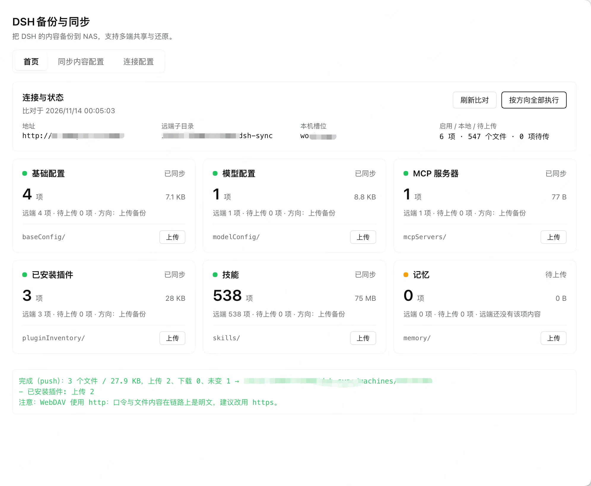
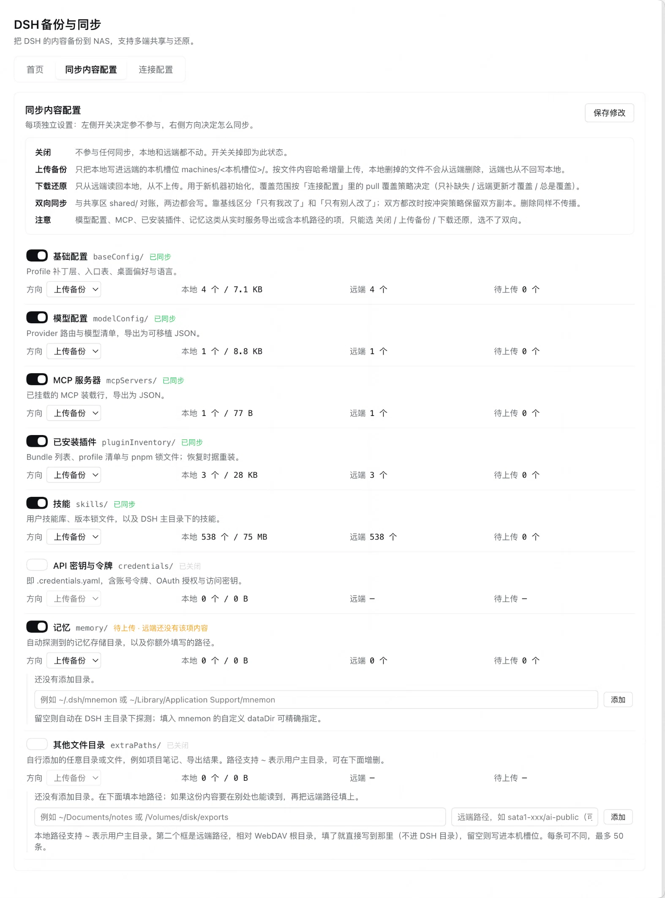
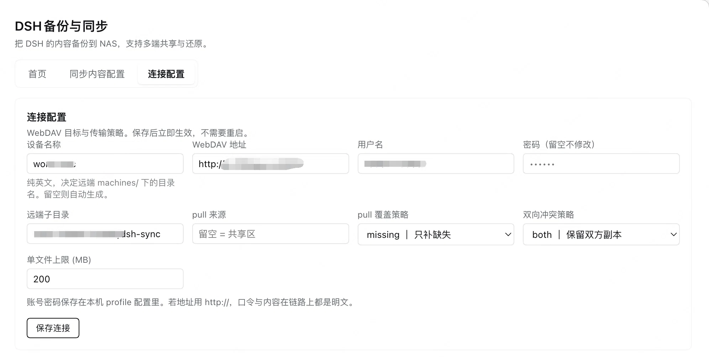

# dsh-sync

把 DeepSeek Harness 的内容备份与同步到远程存储。当前支持 WebDAV，后续会支持 GitHub 同步。

可备份与同步的项目：

| 内容项 | 包含什么 |
| --- | --- |
| 基础配置 | `cordis.patch.yml`、`cordis.yml`、桌面偏好、语言 |
| 模型配置 | Provider 路由与模型清单，导出为 JSON |
| MCP 服务器 | 已挂载的 MCP 装载行，导出为 JSON |
| 已安装插件 | Profile 的 `package.json`、`pnpm-lock.yaml`、`pnpm-workspace.yaml` |
| 技能 | `~/.agents/skills` 与版本锁文件 |
| API 密钥与令牌 | `.credentials.yaml`（默认关闭） |
| 记忆 | 你指定的记忆存储目录 |
| 其他文件目录 | 你自行添加的任意目录或文件，可指定独立的远端位置 |

每一项都能单独开关。侧栏有一个独立的 **备份与同步** 面板。

## 界面







面板分三页：

- **首页**：每个内容项一张状态卡（本地/远端文件数、待上传数），以及「刷新比对」「按方向全部执行」。
- **同步内容配置**：每项的开关、方向、目录列表，改完需手动保存。
- **连接配置**：WebDAV 地址与凭据、远端子目录、设备名称与双向冲突策略。

## 两种同步方向

每一项自己决定方向，一次运行按方向分组执行。

| 方向 | 行为 |
| --- | --- |
| 关闭 | 不参与任何同步。 |
| 上传备份 | 写进这台机器的槽位 `machines/<设备名>/`。按文件内容哈希增量上传，永不删除远端，也永不回写本地。 |
| 双向同步 | 与共享区 `shared/` 对账。靠基线区分「只有我改了」和「只有别人改了」；双方都改时保留双方副本。 |

任何方向都不传播删除——本地删掉的文件在远端仍然保留。

模型配置、MCP、已安装插件这类从实时服务导出或含本机路径的项，常规方向只提供上传备份，不做双向对账。

## 一次性下载还原

在「同步内容配置」中点击对应项右上角「下载还原」，选择某台设备的备份或双向共享区，再点击「确认覆盖并还原」。远端文件覆盖本地同名文件，并补齐缺失文件；本地其他文件不会删除，同步方向和开关不改变。还原仅使用已保存配置，不使用未保存草稿。

- 模型与 MCP 是脱敏 JSON 导出快照，不能直接覆盖运行配置；按钮会解释限制，可通过基础配置备份恢复或手动导入。
- 基础配置和凭据恢复后可能需要重启 DSH；插件清单恢复后需重新安装依赖。
- 自定义远端目录按已保存的独立位置读取，不随设备来源切换。自定义本地目录需预先保存；还原拒绝越界路径、符号链接及超大文件。
- 此操作会丢失被覆盖的本地修改，只有确认后才写入。本地没有对应备份的文件不删除。

## 远端目录结构

```
<远端根>/<远端子目录>/
  machines/<设备名>/<内容项>/<根标记>/…        单向备份，每台机器一个槽位
  machines/<设备名>/.dsh-nas-sync/manifest.json   已上传文件的 sha256 清单
  shared/<内容项>/<根标记>/…                   双向同步的共享区
  shared/.dsh-nas-sync/base-<设备名>.json      本机的双向基线
```

`<根标记>` 记录文件来自哪个本地根目录（`dsh` = DSH 主目录，`agents` = `~/.agents`，`home` = 用户主目录，`abs` = 其他绝对路径），有了它，下载还原才能把文件放回原来的绝对路径。

内容项自身的远端目录会直接显示在面板每一行上。

## Agent 工具

插件注册一个工具：

- `nas_sync` —— `{ action: "plan" | "run", items?, mode?, dryRun? }`。`plan` 只算差异不写任何东西；`run` 真正传输。

## 安装

```
dsh plugin add github:stone-yu/dsh-sync
```

也可以在 DSH 的 **插件 → 添加插件** 里指向本仓库。

安装包名为 `@stone-yu/dsh-sync`（仓库名仍为 `stone-yu/dsh-sync`），以避免与市场中的其他同名插件冲突。配置项标识仍为 `nas-sync`。从旧的无 scope 包名升级时，先保留旧连接与同步设置，再迁移到新包；包名变更不保证自动继承旧配置。

## 已知限制

- **API 密钥是明文。** 开启那项后 `.credentials.yaml` 会以未加密形式上传，能读取远端副本的人可以直接使用其中的令牌。默认关闭。
- **`http://` 是明文链路。** 只要地址不是 https，每次运行都会提示。
- **`link:` / `file:` 依赖不做重写。** 含本机绝对路径的 profile `package.json` 会原样备份，换机器需手工修正。
- **双向同步不做文本合并。** 冲突文件会被保存为 `<文件>.conflict-<设备名>-<时间戳>`，而不是合并成一个。
- **比对需要枚举远端目录。** 打开面板先按配置渲染，数字在后台补齐；远端目录清单缓存 15 秒，点「刷新比对」时绕过硬缓存。

## 许可

MIT
